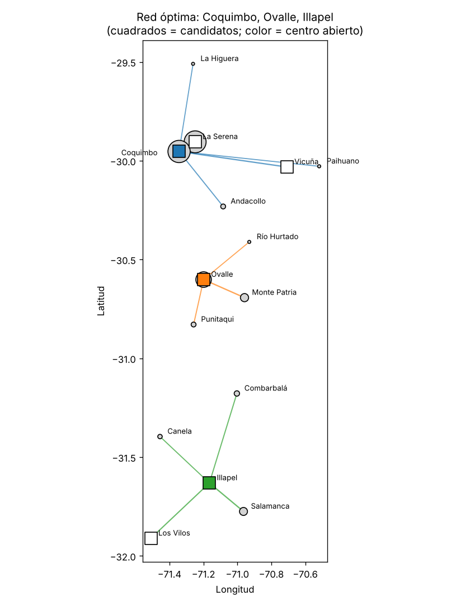
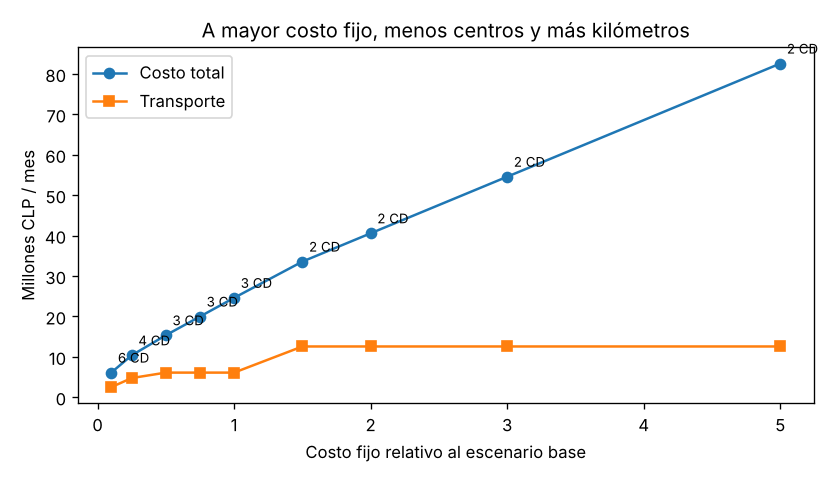

# ¿Dónde abrir centros de distribución? Localización con costo fijo y capacidad

Modelo de programación entera mixta que decide **qué centros de distribución abrir** y **desde cuál abastecer a cada comuna**, equilibrando el costo fijo de cada bodega con el costo de transporte.



## Resultados

**Parte A – Ayudantía del ramo** (5 clientes, 3 centros): se reproduce el óptimo de la pauta, **18.470**.

**Parte B – Región de Coquimbo** (15 comunas, 6 ciudades candidatas, 15.152 cajas/mes):

| Escenario de costo fijo | Centros abiertos | Costo total (MM CLP/mes) | Transporte (MM) |
|---|---|---|---|
| × 0,25 | Coquimbo, Ovalle, Vicuña, Illapel | 10,4 | 4,7 |
| **Base** | **Coquimbo, Ovalle, Illapel** | **24,6** | **6,1** |
| × 1,5 o más | Coquimbo, Ovalle | 33,6 | 12,6 |

- La conurbación La Serena–Coquimbo concentra ~59 % de la demanda: siempre conviene un centro ahí.
- En el escenario base la red óptima es un centro por provincia (Elqui, Limarí, Choapa).
- Si arrendar bodega sube 50 % o más, conviene cerrar Illapel aunque el transporte se duplique.



La asignación comuna → centro queda en [`data/asignacion_region_coquimbo.csv`](data/asignacion_region_coquimbo.csv).

## Supuestos (editables en el notebook)
- Demanda = 2 cajas/mes por cada 100 habitantes (población aproximada del Censo 2017).
- Distancia por carretera ≈ 1,35 × distancia en línea recta entre capitales comunales; transporte $25 por caja-km.
- Costos fijos (4–9 MM/mes) y capacidades (3.000–12.000 cajas) ilustrativos según el tamaño de la ciudad.

Son supuestos para mostrar el método; con ventas reales y la matriz de la red vial el modelo queda listo para usarse.

## Tecnología
Python, **PuLP + CBC** (gratis), pandas, matplotlib. La ayudantía original se resolvió en Gurobi y PuLP; aquí se reproduce el mismo modelo.

## Cómo ejecutarlo

```bash
pip install -r requirements.txt
jupyter notebook notebooks/localizacion_cd.ipynb
```

## Relacionado
Esta es la decisión estratégica (dónde ubicar bodegas). La operación diaria (cómo repartir desde cada bodega) está en el repo **vrptw-ruteo-farmacias**.

## Origen
Rehecho y ampliado a partir de la Ayudantía 6 de Investigación de Operaciones, Ingeniería Civil Industrial, UCN (2024).

**Autor:** Mario Coroseo Ramos
